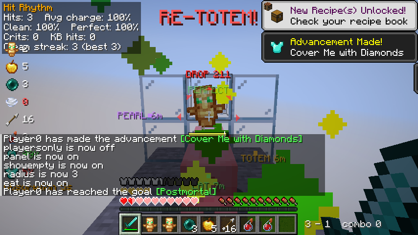

# Minecraft mods

Client-side [Fabric](https://fabricmc.net/) mods. Each folder is its own Gradle project with its
own README.

## PvP mods (Minecraft 26.1.2)

Five original mods for 1.9+ combat. They only show you information about your own
character, your surroundings and sounds you can already hear. None of them click,
aim, move or act for you.

| Mod | What it does |
| --- | --- |
| [Hit Rhythm](hit-rhythm/) | Attack-timing coach. Plays a tick the moment your weapon is fully charged, grades every hit (Perfect / Good / Early, plus Crit and KB tags) and tracks your session stats. |
| [Ledge Sense](ledge-sense/) | A ring of arrows around the crosshair pointing at nearby void, lava and dangerous drops, colored by how deadly the fall would be, plus an alarm if you're hit next to one. |
| [Kit Watch](kit-watch/) | Counts totems, gapples, pearls, wind charges, arrows and healing pots, flags low stock and failing armor, counts down expiring buffs, and shouts RE-TOTEM after an offhand pop. |
| [Fight Recap](fight-recap/) | A post-match report for every fight: server-confirmed hits vs. swings, crits, combos both ways, damage, consumables and totem pops, and a CSV log of every fight. |
| [Threat Pings](threat-pings/) | Turns combat sounds (pearls, bows, potions, gapples, totems, shields, explosions…) into directional pings around the crosshair, so you see where they came from. |

*All five running together in the automated smoke test (on a deliberately tiny 854×480 window).
Top left: Hit Rhythm's stats panel and the Kit Watch column. Top center: Kit Watch's RE-TOTEM
after a totem pop. Around the crosshair: Ledge Sense's red arrows (`DROP 211`) and Threat Pings
(`PEARL`, `TOTEM`). Right of the hotbar: Fight Recap's live score.*

They need Fabric Loader 0.20.1+, Fabric API for 26.1.2 and Java 25, and they work with
each other in any combination. Default keys: **H** Hit Rhythm panel, **J** Ledge Sense,
**K** Kit Watch panel, **N** last Fight Recap, **U** Threat Pings. You can rebind them all
in *Options → Controls → Key Binds*.

## Other

| Mod | What it does |
| --- | --- |
| [Mode Switcher](mode-switcher/) (1.21.11) | One key switches your settings between a Vanilla and a PvP profile. |

## Building

Every push that touches `mc-mods/` builds all mods in GitHub Actions
(`.github/workflows/build-mod.yml`). Each jar is uploaded as a workflow artifact. On
`main`, or when you start the workflow by hand, the jars are also committed to each mod's
`dist/` folder. Ready-to-use jars are in each mod's `dist/` folder.
To build one locally, run `./gradlew build` in its folder. The 26.1.2 mods
need Java 25.

After the build, CI also runs [pvp-smoke-test](pvp-smoke-test/). It boots a real 26.1.2 client
with all five mods and plays through a scripted fight to check they load and work together.
